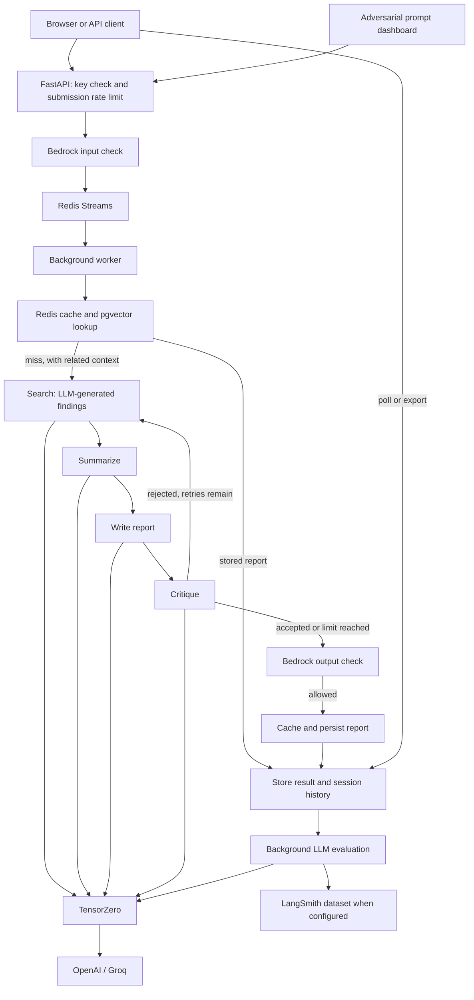

# Multi-Agent Research Platform

A Python application that turns a topic into a report through a LangGraph workflow, with a browser interface, asynchronous jobs, report memory, and AWS Bedrock content checks. It includes a separate dashboard for exercising the API with fixed adversarial prompts and Terraform definitions for an AWS deployment.

The research stage generates findings through an LLM; it does not search the web or retrieve cited sources. Reports and evaluation scores need independent review.

## Features

- Search, summarize, write, and critique stages, with a bounded retry loop when the critic rejects a report.
- Redis Streams jobs with polling, expiring results, semantic caching, and session history.
- PostgreSQL with pgvector for storing reports and retrieving related topics.
- Bedrock checks on submitted topics and newly generated reports.
- Text reports, PDF downloads, structured JSON metadata, and differences between stored reports.
- Optional shared API key, submission rate limiting, LangSmith tracing, and four LLM judge prompts.
- A dashboard containing jailbreak, prompt injection, escalating prompt, and authority-framing examples.
- Dockerfiles, AWS infrastructure definitions, and a manually triggered deployment workflow.

## Technology stack

| Area | Implementation |
| --- | --- |
| API | Python 3.12, FastAPI, Pydantic, Uvicorn, HTTPX |
| Orchestration | LangGraph, LangChain Core, LangSmith |
| Model gateway | TensorZero; configured for OpenAI `gpt-4o` with Groq `llama-3.1-8b-instant` fallback |
| Embeddings | Sentence Transformers `all-MiniLM-L6-v2`, NumPy; 384 dimensions |
| Storage | Redis, PostgreSQL, pgvector, asyncpg |
| Reports and UI | ReportLab; plain HTML, CSS, and JavaScript |
| Adversarial dashboard | Python 3.11 container, FastAPI, PyRIT 0.14.0 initialization, direct HTTP requests |
| Infrastructure | Terraform, AWS ECS Fargate, ECR, ALB, RDS, ElastiCache, Secrets Manager, Bedrock, CloudWatch, EventBridge |
| Delivery | Docker, GitHub Actions |

Dependency declarations are in [requirements.txt](requirements.txt) and [pyrit_dashboard/requirements.txt](pyrit_dashboard/requirements.txt). Version availability and compatibility have not been verified by an installation.

## Architecture



The API reads `research-agent/config` from AWS Secrets Manager during module import. Startup connects to Redis and PostgreSQL, creates the pgvector extension/table/indexes, builds the graph, and launches an in-process worker. It therefore requires those services even for local development.

## Installation and configuration

Prerequisites are Python 3.12 for the main API, AWS credentials with access to the configured secret and Bedrock guardrail, reachable Redis and PostgreSQL with pgvector, and a running TensorZero gateway. Docker is needed for the supplied container build commands. AWS deployment additionally requires the AWS CLI and Terraform.

From the project root:

```bash
python3.12 -m venv .venv
source .venv/bin/activate
python -m pip install -r requirements.txt
cp .env.example .env
cp config/secrets.example.json config/secrets.local.json
```

On Windows, activate with `.venv\Scripts\activate` instead. Edit the local copies; both are ignored by Git.

**`.env` is not automatically loaded by the application.** The two configuration sources serve different purposes:

| Source | Values and consumers |
| --- | --- |
| Process environment | API: `AWS_REGION` selects the Secrets Manager region. TensorZero: `OPENAI_API_KEY`, `GROQ_API_KEY`. Dashboard: `TARGET_URL`, `REDIS_URL`. |
| Secrets Manager JSON | API: `BEDROCK_GUARDRAIL_ID`, `BEDROCK_GUARDRAIL_VERSION`, `REDIS_URL`, `DATABASE_URL`, `TENSORZERO_URL`; optional `API_KEY`, LangSmith settings, and tuning values. ECS also injects provider keys into TensorZero from this secret. |

[config/secrets.example.json](config/secrets.example.json) contains the required API fields and provider placeholders. Replace every `REPLACE_ME` before use. Addresses must be reachable **from the consuming process or container**: `localhost` refers to that process's host/container. Use an AWS profile, SSO session, or IAM role for AWS authentication. No AWS credentials belong in tracked files.

For a manually provisioned development environment, create the secret with:

```bash
aws secretsmanager create-secret \
  --name research-agent/config \
  --secret-string file://config/secrets.local.json \
  --region us-east-1
```

For an existing secret, use `put-secret-value --secret-id research-agent/config` with the same file and region arguments. This replaces the whole JSON value: preserve existing infrastructure endpoints and other settings. For Terraform-managed deployments, edit the provisioned secret instead of creating another one; see [AWS deployment](docs/deployment.md).

Set `API_KEY` to a private shared key to enable `X-API-Key` checks; an empty or absent value disables authentication. Leave `LANGSMITH_API_KEY` empty to omit tracing configuration. LLM evaluation still runs even without a LangSmith key, so it can incur model calls. Numeric tuning defaults are defined in [app/config.py](app/config.py); the Terraform secret also supplies them.

## Running the application

Start the gateway after replacing the provider placeholders in `.env`:

```bash
docker build -f tensorzero/Dockerfile -t research-agent-tensorzero .
docker run --rm --env-file .env -p 127.0.0.1:3000:3000 research-agent-tensorzero
```

With Redis, PostgreSQL, AWS configuration, and TensorZero ready, start the API from the project root in another terminal:

```bash
source .venv/bin/activate
export AWS_REGION=us-east-1
uvicorn app.main:app --host 127.0.0.1 --port 8000
```

The first import downloads the embedding model unless already cached. The database user needs permission to create the `vector` extension, tables, and indexes. The supplied app Dockerfile preloads the model during its build.

The API's `/` route uses the container path `/app/index.html`. For a host Python run, serve the UI separately:

```bash
python3 -m http.server 8080 --bind 127.0.0.1
```

Open `http://localhost:8080/index.html` (use **localhost**, matching the frontend's API routing). Inside the supplied app container, the UI is served at `/` on port 8000. API documentation is available at `http://localhost:8000/docs` after successful startup.

To run the optional dashboard in a separate Python 3.11 environment:

```bash
python3.11 -m venv .venv-pyrit
source .venv-pyrit/bin/activate
python -m pip install -r pyrit_dashboard/requirements.txt
export TARGET_URL=http://localhost:8000
export REDIS_URL=redis://localhost:6379/0
uvicorn pyrit_dashboard.main:app --host 127.0.0.1 --port 8001
```

Open `http://localhost:8001/`. The current target client does not send an API key, so it cannot meaningfully exercise a key-protected API. Results expire from Redis after seven days. Without `REDIS_URL`, results are not retained for display.

## API usage

Use your configured shared key below. Omit the header only when authentication is disabled.

```bash
curl -X POST http://localhost:8000/research \
  -H 'Content-Type: application/json' \
  -H 'X-API-Key: REPLACE_ME' \
  -d '{"topic":"Applications of vector databases","session_id":"demo","output_format":"text"}'

curl http://localhost:8000/result/JOB_ID -H 'X-API-Key: REPLACE_ME'
curl http://localhost:8000/result/JOB_ID/pdf \
  -H 'X-API-Key: REPLACE_ME' -o report.pdf
```

Submission returns `job_id` and `session_id`. Poll for `pending`, `done`, `blocked`, or `error`. Supported output branches are `text`, `pdf`, and `json`; the request model does not enforce an enum.

| Method | Route | Purpose |
| --- | --- | --- |
| GET | `/health` | Redis status; no API key required |
| POST | `/research` | Submit a topic |
| GET | `/result/{job_id}` | Poll a result |
| GET | `/result/{job_id}/pdf` | Download a completed report |
| GET | `/session/{session_id}` | Read session history |
| GET | `/diff/{topic}` | Compare similar stored reports; URL-encode the topic |
| GET | `/stats` | Redis usage and selected configuration |
| GET | `/evaluate/{job_id}` | Run the four judge prompts again |
| POST | `/run-evaluation` | Start batch evaluation with `{"topics":["example"]}` or `{}` for recent topics |

Dashboard routes include `/`, `/status`, `/results`, and `/run-attacks?types=jailbreak,xpia,crescendo,skeleton_key`. They have no authentication.

## Project structure

```text
.
├── app/                    # API, graph, storage, checks, evaluation, exports
├── config/
│   └── secrets.example.json # Placeholder Secrets Manager document
├── docs/
│   ├── deployment.md       # AWS setup sequence and deployment caveats
│   └── validation.md       # Publication checks and untested integrations
├── pyrit_dashboard/        # Adversarial prompt dashboard and its Dockerfile
├── tensorzero/             # Gateway configuration, templates, Dockerfile
├── terraform/main.tf       # AWS resources
├── .github/workflows/      # Manually triggered image build and ECS deployment
├── .env.example            # Process environment examples
├── .gitignore              # Local files, credentials, caches, and state exclusions
├── .dockerignore           # Keep local files out of container build contexts
├── .gitattributes          # Text and line-ending rules
├── bootstrap.sh            # AWS state backend creation (Unix)
├── bootstrap.bat           # AWS state backend creation (Windows)
├── index.html              # Browser client
├── requirements.txt        # API dependency declarations
└── README.md
```

The original downloaded materials, including their diagrams and source-link file, are preserved locally under `local-backup/` and excluded from Git and Docker contexts. The supplied source link points to [data-guru0/AI-Security-Project](https://github.com/data-guru0/AI-Security-Project). No license or copyright notice file was present in the supplied bundle; this preparation does not add a new license or claim original authorship.

## Known limitations

- There is no web search, source retrieval, citation validation, or independent fact-checking. A report is returned after the iteration limit even if the critic still rejects it.
- Semantic cache and report memory are shared across sessions and matched by topic. Cache hits bypass the graph and a fresh output guardrail check; cached content can ignore session context.
- Guardrail responses are checked for intervention, but any returned anonymized text is not substituted into requests or reports.
- Workers do not reclaim abandoned pending messages, limit concurrent jobs, or trim the stream. Expired and unknown job IDs both appear pending. Evaluation tasks are not durable.
- The API has a single optional shared key, permissive CORS, and no per-user ownership checks. The UI stores the key in browser storage and inserts session messages as HTML without escaping. Its PDF button omits the key header; use authenticated `curl` for downloads.
- The dashboard sends fixed prompts directly through HTTP after initializing PyRIT. It does not run PyRIT attack orchestrators or explicitly record each attack in PyRIT memory. Its escalating prompts use new sessions, and errors/authentication failures can be counted as successful blocks. Risk scores are heuristics, not measured safety guarantees.
- The AWS defaults use HTTP unless an ACM certificate is supplied; dashboard port 8001 remains HTTP and publicly exposed. Restrict access before deployment. The schedule launches another dashboard server, not an attack run.
- The deployment workflow assumes fixed AWS resource names and does not provision infrastructure. TensorZero uses a floating `latest` image; dashboard dependencies are partly unpinned. Dependency compatibility, model availability, and cloud deployment remain unverified.
- `/health` checks Redis only and returns HTTP 200 even when degraded. PostgreSQL, model providers, and guardrails are not covered by that check.

See [validation status](docs/validation.md) for the checks actually completed. This repository is an integration example, not a verified production deployment.
